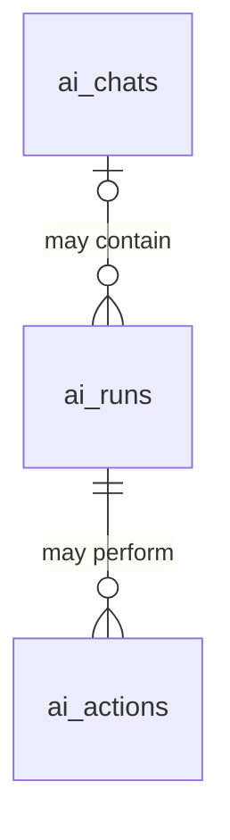

# Proposed AI data structure

**Draft for review. This describes the proposed design; the application and database schema have not been changed to match it.**

A **chat** is the entire saved exchange between a user and the agent. A **run** is the agent working on one request. An **action** is one completed operation that changed app data.

A chat starts runs. Each run can produce replies, perform actions, or do both. A schedule can also start a run without a user-facing chat.

## Three tables

| Table | One row represents | Can exist without |
| --- | --- | --- |
| `ai_chats` | One whole saved chat | Runs or actions, such as an empty chat |
| `ai_runs` | One execution of the agent | A chat or any actions |
| `ai_actions` | One successfully committed app operation | A chat, when its run has no chat; a run is always required |

The app can load these related records together and display one chat timeline. Separate storage does not require separate screens.

## ai_chats — the whole chat

| Column | What it stores |
| --- | --- |
| `chat_id` | The exact chat/session ID used by Hermes; no second chat ID or mapping table |
| `company_id` | Company that owns the chat |
| `user_id` | User who owns the chat |
| `title` | The chat's display title |
| `created_timestamp` | When the chat was created |

The proposed key is `(company_id, user_id, chat_id)`.

**Messages and replies remain in Hermes's existing transcript storage.** This Mango row describes the chat; it does not contain a growing JSON copy of all messages. Searchable history imports and backups remain separate later work.

## ai_runs — one execution

| Column | What it stores |
| --- | --- |
| `run_id` | Mango's stable execution ID, created before sending; replaces the current `request_id` |
| `company_id` | Company the execution belongs to |
| `user_id` | User whose authority applies to the execution |
| `chat_id` | Optional link to a chat in that same company and user scope |
| `hermes_run_id` | Hermes's execution ID, absent until known; replaces the current `run_id` |
| `status` | `active`, `stopping`, or `finished` |
| `message` | Original input retained while sending is uncertain; cleared once the Hermes execution is linked or the run is closed |
| `created_timestamp` | When Mango first records the run, before submitting it to Hermes; used to limit uncertain retries |

The proposed key is `(company_id, user_id, run_id)`. The optional chat link uses `(company_id, user_id, chat_id)`.

**One status replaces both flags:** `active` covers pending acceptance and execution; `stopping` blocks further changes while execution stops; `finished` closes the run. Detailed completion, failure and cancellation outcomes continue to come from Hermes. A late response must never reopen a stopped or finished run.

**No `payload_hash`:** a run ID always refers to its original submission. An uncertain retry sends the saved original message and chat, never replacement input. An existing accepted ID returns its original run. A different request must receive a new run ID. This changes the current behavior, which rejects changed input under an existing ID.

Mango and Hermes IDs have different purposes: Mango needs an ID before making the network request, while the pinned Hermes version assigns its own execution ID. Both are needed to recover when acceptance succeeds but the response is lost.

## ai_actions — completed app changes

| Column | What it stores |
| --- | --- |
| `company_id` | Company scope, matching the run |
| `user_id` | User scope, matching the run |
| `run_id` | Required link to the Mango run that performed the action |
| `action_name` | Operation name, such as `mango_create_node` |
| `action_key` | Key that recognizes repeated arguments for that operation within the same run |
| `outcome` | Saved JSON result returned by the committed operation |

The proposed key is `(company_id, user_id, run_id, action_name, action_key)`. The run link uses `(company_id, user_id, run_id)`.

Every operation uses this shared table. Reads and failed attempts create no action receipt. The result and app change commit together, so a retry returns the original outcome without performing the change again.

An action's chat is found through its run. There is no additional `chat_id` on the action. Receipts remain historical evidence after an affected business resource is deleted; replaying one must never recreate that resource.

## Examples

| Example | Chat | Run | Actions |
| --- | --- | --- | --- |
| Create an empty saved chat | Yes | None yet | None |
| Say hello and receive a reply | Yes | One | None |
| Ask the agent to create a task | Yes | One | One or more, depending on the requested work |
| Ask another question in that chat | Same chat | Another run | Optional |
| Scheduled analysis | Optional | One per execution | Optional |
| Scheduled task creation | Optional | One per execution | Yes, if creation succeeds |

## Schedules and remaining implementation decisions

A schedule defines what to run and when. Each occurrence creates an ordinary `ai_runs` row. A separate table just for scheduled executions is unnecessary. Scheduled execution is not implemented in the current integration; schedule definitions and their authorization will be addressed when that capability is built.

Before implementation, define chat-title ownership and chat deletion behavior. Deleting a chat must not casually erase retry protection for committed operations. Company and user access checks, permanent deletion cleanup, and run/action links must follow the existing [relationship laws](tests/relationships.md).

The current implementation remains documented in [Hermes integration laws](tests/hermes.md). This proposal does not replace those laws until implementation updates them.
